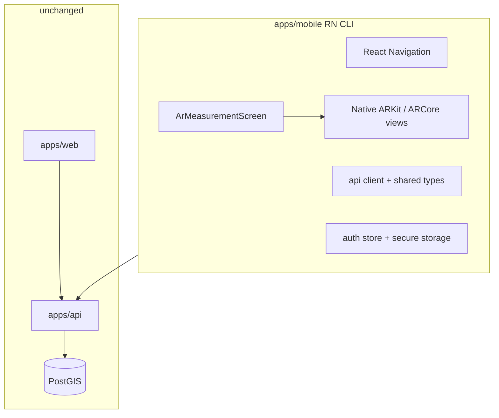

# CampusAR Web → React Native CLI Migration Report

**Date:** 2026-10-24  
**Environment audited on:** Windows 10, Node v22.18.0, OpenJDK 17.0.16  
**iOS build / physical iPhone testing:** Not available in this environment (requires macOS + Xcode).

---

## 1. Existing architecture

| Layer | Technology | Location |
|-------|------------|----------|
| Monorepo | npm workspaces | Root `package.json` → `apps/*`, `packages/*` |
| Web frontend | React 18.3, Vite 6, TypeScript 5.7, Tailwind 3, React Router 7 | `apps/web` |
| API | Express 4, Zod, JWT, WebSocket, bcrypt | `apps/api` |
| Shared DTOs | TypeScript package | `packages/shared` |
| Database | PostgreSQL 16 + PostGIS | `apps/api/src/infrastructure/db` |
| Ops | Docker Compose | `docker-compose.yml` |
| Unity scaffold | AR Foundation 2022.3 LTS (C#) | `unity/CampusAR` |

### Web routes (`apps/web/src/App.tsx`)

| Path | Feature |
|------|---------|
| `/` | Landing / login |
| `/map` | Campus map (Leaflet / MapLibre / Google) |
| `/navigate` | Outdoor turn-by-turn |
| `/ar` | Web AR navigation (camera + compass + Three.js doll) |
| `/indoor` | Indoor QR localization + guidance |
| `/digital-twin` | CesiumJS twin |
| `/safety` | Safety |
| `/admin/map-builder` | Outdoor graph editor |
| `/admin/map-builder/indoor/:buildingId?` | Indoor layout + **AR measure panel** |
| `/admin`, `/analytics` | Admin (role-gated) |

### Authentication

- JWT access + refresh tokens (`jsonwebtoken` on API).
- Web: Zustand `authStore` with `persist` → **browser localStorage** (`campusar-auth`).
- API client: `apps/web/src/lib/api.ts` — `fetch`, automatic refresh via `/auth/refresh`, `Authorization: Bearer`, site header from `siteStore`.
- Default API base: same-origin `/api` (Vite proxy / nginx); overridable via `VITE_API_URL`.

### State management

- Zustand stores: `authStore`, `siteStore`, `previewStore`, `themeStore`, navigation-related hooks.

### Navigation / maps

- **Outdoor:** A* on campus graph (`apps/api/src/domain/routing`), GPS via `useGeolocation`, maps via Leaflet, MapLibre GL, optional Google Maps.
- **Indoor:** Local-meter graph, QR anchor resolution (`indoorResolveAnchor`), indoor routing API, floor layouts.
- **Map builder:** Terra-draw / Geoman on MapLibre; indoor floor editor; publish/validate map versions.

### AR measurement (problem area)

| Mode | Implementation | World tracking |
|------|----------------|----------------|
| Safari / iOS camera fallback | `IndoorArMeasurePanel` + `indoorArMeasure.ts` | **DeviceOrientation + DeviceMotion integration** (`PoseTracker`), floor ray from phone attitude — **drifts when user walks** |
| WebXR (Chrome Android) | `webXrSessionManager.ts`, hit-test, anchors | Real ARCore hit-test in supported browsers |
| Unity (separate client) | `IndoorMapperController`, AR Foundation raycast | Native ARKit/ARCore (not wired to web app) |

Key files:

- `apps/web/src/features/mapBuilder/IndoorArMeasurePanel.tsx` — UI + session lifecycle
- `apps/web/src/features/mapBuilder/indoorArMeasure.ts` — camera, permissions, pose integration, projection
- `apps/web/src/features/mapBuilder/webXrSessionManager.ts` — WebXR/ARCore path
- `apps/web/src/features/mapBuilder/arMeasureAnchors.ts` — anchor helpers
- Backend: `measurementRoutes.ts`, `measurementPathService.ts`, spatial fields on `MeasurementPoint` (`worldPosition`, `worldTransform`, `trackingState`)

### Measurement API (preserved for mobile)

- `POST /api/measurements/paths`, points, bulk GPS, spatial metadata — see `apps/api/src/interfaces/http/routes/measurementRoutes.ts`.
- Shared types: `packages/shared/src/types/measurement.ts`, `spatialTypes.ts`.

### Browser-only dependencies (web)

| Package | Use | RN compatibility |
|---------|-----|------------------|
| `leaflet`, `react-leaflet` | 2D maps | Replace with `@rnmapbox/maps` or `react-native-maps` |
| `maplibre-gl`, `terra-draw-*` | Map builder | Native map + custom draw layer or WebView admin-only |
| `cesium` | Digital twin | `@maplibre/maps` + simplified twin or WebView for admin |
| `three`, `@react-three/fiber`, `@react-three/drei` | AR doll, WebXR rendering | Native AR scene or `react-native-filament` / skip doll in v1 mobile |
| `html5-qrcode` (root dep) | QR scan | `react-native-vision-camera` + code scanner |
| `vite`, `tailwindcss` | Build / styling | N/A — StyleSheet / NativeWind optional |
| `getUserMedia`, WebXR, DeviceMotion | AR | **Native ARKit / ARCore modules** |

### Unity assets (retain)

`unity/CampusAR` contains reusable **design reference** for indoor AR mapping (raycast reticle, graph editor, API client). Not deleted; mobile native modules mirror similar semantics.

---

## 2. Features that can be reused

- **Entire backend** (`apps/api`) unchanged for mobile clients.
- **`@campusar/shared`** types and pure algorithms ported or imported after Metro bundler config (workspace package).
- **API contracts** for auth, campus, routing, indoor, measurements, map builder.
- **Domain logic** in API and pure TS in web: `geo.ts`, `navigationHeading.ts`, `buildingNavigation.ts`, `pathCircuit.ts`, map builder validation tests (re-run against extracted modules).
- **Unity C#** as reference for AR UX (not runtime dependency).

---

## 3. Features requiring React Native rewrite

- All pages using DOM, CSS, React Router → React Navigation screens.
- Zustand persist → `@react-native-async-storage/async-storage` adapter.
- `api.ts` → mobile client without `import.meta.env` / `localStorage`; use `react-native-config` or build-time env.
- Map pages, admin dashboards, charts (`recharts`), Cesium twin.
- Web AR page (`ArPage`) — compass overlay navigation (GPS + heading), optional simplified HUD without Three.js doll initially.
- Indoor QR scanner — native camera.
- Map builder — large surface area; prioritize read-only map + measurement workflow first, defer full Terra-draw parity.

---

## 4. Features requiring native iOS (ARKit)

- Indoor/admin **AR measurement** with `ARWorldTrackingConfiguration`, raycast, anchors, world-space points, line rendering, tracking state, session lifecycle.
- Camera permission (`NSCameraUsageDescription`).
- Optional: `ARWorldMap` persistence (investigate; not guaranteed cross-session).

**Prepared in repo:** `apps/mobile/ios` native module `CampusARMeasure` (Swift) — requires Mac/Xcode to compile and device test.

---

## 5. Features requiring native Android (ARCore)

- Parallel measurement module using ARCore `Session`, `Frame.hitTest`, anchors, OpenGL/SceneView rendering.
- `CAMERA` permission, ARCore meta-data in manifest, graceful degrade on unsupported devices.

**Prepared in repo:** `apps/mobile/android` module `CampusARMeasure` (Kotlin) — buildable on Windows with Android SDK.

---

## 6. Incompatible dependencies (summary)

See table in §1. Do not install web map/Three/Cesium packages into mobile.

---

## 7. Proposed architecture and migration order

| Phase | Deliverable | Status |
|-------|-------------|--------|
| 1 | This audit | Done |
| 2 | RN CLI scaffold `apps/mobile`, docs | In progress |
| 3 | Shared API + auth + navigation shell | In progress |
| 4 | Native iOS ARKit measure module + RN screen | Implemented (source); **not device-tested** |
| 5 | Native Android ARCore measure module | Implemented (source); emulator/device test pending |
| 6 | Port indoor QR, outdoor map, map builder | Pending |
| 7 | Automated tests for shared logic | Partial (reuse vitest packages) |
| 8 | macOS build guide | See `docs/native-build-guide.md` |

**RN version choice:** 0.77.3 — aligns with Node 20+ and JDK 17 available in this environment.

---

## 8. Known limitations and risks

| Risk | Mitigation |
|------|------------|
| ARKit world coords ≠ building graph coords | Store session metadata; explicit transform pipeline; never share raw iOS coords with Android |
| Cross-session anchor persistence | Document as best-effort; use backend graph snapping (`snappedX/Y/Z`) |
| Full map-builder on mobile | Phased; web remains authoritative editor until parity |
| Cesium twin size/perf on mobile | Defer or WebView admin-only |
| CORS | Native apps call API directly; configure absolute `API_URL` |
| JWT in AsyncStorage | Acceptable for dev; migrate to Keychain/Keystore for production hardening |
| iOS not buildable on Windows | All Swift sources committed; CI/Mac required |

---

## 9. Platform compatibility matrix

| Capability | iOS | Android | Web (legacy) |
|------------|-----|---------|--------------|
| Auth / JWT | Planned | Planned | Working |
| Outdoor map | Pending | Pending | Working |
| Indoor QR | Pending | Pending | Working |
| AR measure native | Source ready | Source ready | Sensor/WebXR only |
| Map builder | Pending | Pending | Working |
| Physical AR test | **Not run** | **Not run** | N/A |

---

## 10. Search index (audit queries)

| Pattern | Primary hits |
|---------|----------------|
| `DeviceOrientationEvent` / `DeviceMotionEvent` | `IndoorArMeasurePanel.tsx`, `indoorArMeasure.ts`, `useGeolocation.ts`, `IndoorArNavigator.tsx` |
| WebGL / Three.js | `GuideDoll.tsx`, `ArPage.tsx`, twin docs |
| WebXR | `webXrSessionManager.ts`, `webxr.d.ts` |
| Mapbox/MapLibre | `CampusMapLibreMap.tsx`, `maplibre-gl` |
| Measurement | `IndoorArMeasurePanel.tsx`, `measurementRoutes.ts`, `packages/shared/.../measurement.ts` |
| React Router | `App.tsx` |
| AR anchors | `arMeasureAnchors.ts`, Unity `IndoorMapperController.cs` |
